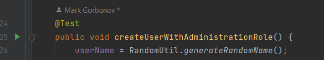

Repository for test task implementation

---  

### Task 1:  

Test cases for task 1 located in testcase/TestCasesForLogin.xlsx file. (Excel)

---  

### Task 2:
Test automation framework created

### Scenarios: 

As it is a system that should be able to run pipelines and receive the results.  
If it is a big company that will have a lot of different people, we should be able to create users and project,
and assign Roles (permission)to split interaction between them, as people may leave and projects may end we need to possibility of deletion.
  
If it is small company we don't need so strict rules, but we still need users to create/run our pipelines

So The following scenarios were chosen:  
Per project permission enabled:  
1. Possibility to create user and assign Role to that user
2. Possibility to delete user
3. Possibility to create Project\Build
4. Possibility to delete Project\Build
5. Possibility to run successful and failed builds
6. Possibility to run builds by newly created user

Per project permission disabled:
1. Possibility to create user with\without admin permission
2. Possibility to delete user
3. Possibility to create Project\Build
4. Possibility to delete Project\Build
5. Possibility to run successful and failed builds
6. Possibility to run builds by newly created user

Framework mostly cover Ui scenarios, API module also added but mostly used for preconditions right now  
It is planed to cover more varied scenarios using API, and leave for UI most important functionality

#### How to Run examples:  
For successful run you should have java 17+ installed.  
You need to start up teamcity application, docker-compose file example in directory
You need to authorize at least one agent at default pool, with task gradle, that able to run java tests
You need specify credentials for admin user in admin_credentials.properties files.  
You need specify baseUrl in dev/local.properties files.

UI:  
From the root folder - "./gradlew clean -Dsuite=users -Dbrowser=chrome -Denv=local runUiTests"

API:
From the root folder - "./gradlew clean runApiTests"   

####   Test Results file/folder:  
  - `ui\build\reports\tests\runUiTests\index.html`
  - `api\build\reports\tests\runApiTests\index.html`

#### Possible Parameters:
1. env  
   a. local  
   b. dev
2. browser  
   a. chrome
   b. edge
   c. firefox
3. suits (can be found in resources.suits folder, some examples below)  
   a. perProjectEnabled  
   b. perProjectDisabled
  
Parallelization disabled by default, to enable uncomment //parallel 'tests' in build gradle file
  
  
For Single test execution, click on green arrow near test and select appropriate test run method

---
  
### **Things to discuss:**  
1. Do we need common element for table interaction
2. Do we need human-readable logs, or simple text reporter logs are enough
3. Tests splitting by suits/ for parallelization support
4. Storing common/separate env/admin files for api/ui modules
5. @Groups vs xml files for suites organizing
6. TimeStamp for unique random data generation
7. Flaky tests
8. Checkstyle task/stage

---

### _**Bugs**:_  

severity: very low,   
priority: very low  
**Steps to reproduce:**
1. Login as Admin user
2. Open Users tab http://localhost:8112/admin/admin.html?item=users
3. Execute search with any existence user which possible to select(click on checkbox)
4. Click on filter button again    

**Expected result:**  
User actions bottom tab disappear as all selection reset  
**Actual result:**  
User actions bottom tab presented(Add to groups, Remove user)  
on click on Remove nothing will happen